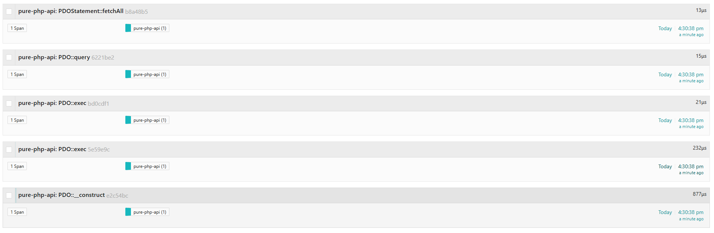
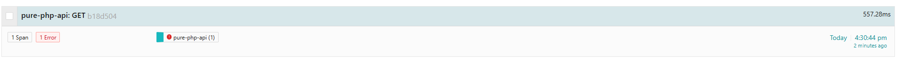

# Initialization
## PHP
1. Download PHP: https://downloads.php.net/~windows/releases/archives/php-8.2.35-1-Win32-vs16-x64.zip
1. Unzip
1. Config windows path
1. Uncomment pada `php.ini`
```ini
extension_dir = "ext"
extension=curl
extension=mbstring
extension=openssl
extension=zip
extension=fileinfo
extension=pdo_sqlite
extension=sqlite3
```
Versi PHP
```powershell
php -v

PHP 8.2.35 (cli) (built: Oct 26 2026 09:53:26) (ZTS Visual C++ 2019 x64)
Copyright (c) The PHP Group
Zend Engine v4.2.35, Copyright (c) Zend Technologies
```
Informasi PHP
```powershell
php -i | findstr /C:"Thread Safety" /C:"Architecture" /C:"PHP Extension Build"

Architecture => x64
PHP Extension Build => API20220829,TS,VS16
Thread Safety => enabled
```

## Composer
1. Download Composer: https://getcomposer.org/Composer-Setup.exe

Versi composer
```powershell
composer --version

Composer version 2.11.1 2026-10-30 14:52:10
PHP version 8.2.35 (C:\php-8.2.35-1-Win32-vs16-x64\php.exe)
Run the "diagnose" command to get more detailed diagnostics output.
```

## Opentelemetry dll
Download, sesuaikan dengan versi PHP yang digunakan, sesuaikan TS vs NTS: `https://github.com/open-telemetry/opentelemetry-php-instrumentation/releases`

Dll versi 8.2 untuk TS: `https://github.com/open-telemetry/opentelemetry-php-instrumentation/releases/download/1.4.2/php_opentelemetry-1.4.2-8.2-ts-vs18-x86_64.zip`

Copy `php_opentelemetry-1.4.2-8.2-ts-vs18-x86_64.dll` ke `.\php\ext` dan rename menjadi `php_opentelemetry.dll`

Add baris berikut ke `php.ini`
```ini
[opentelemetry]
extension=php_opentelemetry.dll
```
## Composer add package
```powershell
composer require open-telemetry/sdk open-telemetry/exporter-otlp php-http/guzzle7-adapter open-telemetry/opentelemetry-auto-pdo open-telemetry/opentelemetry-auto-curl open-telemetry/opentelemetry-auto-io
```

## Run project
```powershell
powershell -ExecutionPolicy Bypass -File .\start.ps1
```

## Hit api dari terminal lain
```powershell
curl http://localhost:8080/items
curl http://localhost:8080/external
```

## Console output sample
```powershell
powershell -ExecutionPolicy Bypass -File .\start_export_to_console.ps1
[Tue Nov  3 16:19:44 2026] PHP 8.2.35 Development Server (http://localhost:8080) started
[Tue Nov  3 16:19:55 2026] [::1]:53199 Accepted
[
    {
        "name": "PDO::__construct",
        "context": {
            "trace_id": "951bccb707ad1c11201d5c2f09c7254f",
            "span_id": "316b7177d9e0f26b",
            "trace_state": "",
            "trace_flags": 1
        },
        "resource": {
            "service.name": "pure-php-api",
            "host.name": "DESKTOP-KM0VSQ2",
            "host.arch": "AMD64",
            "host.id": "f70eb373-e23c-4450-ba25-9d3d9c65359c",
            "os.type": "windows",
            "os.description": "10.0",
            "os.name": "WINNT",
            "os.version": "build 26200 (Windows 11)",
            "process.runtime.name": "cli-server",
            "process.runtime.version": "8.2.35",
            "process.pid": 12936,
            "process.executable.path": "C:\\php-8.2.35-1-Win32-vs16-x64\\php.exe",
            "telemetry.sdk.name": "opentelemetry",
            "telemetry.sdk.language": "php",
            "telemetry.sdk.version": "1.15.0",
            "telemetry.distro.name": "opentelemetry-php-instrumentation",
            "telemetry.distro.version": "1.4.2"
        },
        "parent_span_id": "",
        "kind": "KIND_CLIENT",
        "start": 1793697596038529176,
        "end": 1793697596039297776,
        "attributes": {
            "code.function.name": "PDO::__construct",
            "db.system.name": "sqlite",
            "db.namespace": "memory"
        },
        "status": {
            "code": "Unset",
            "description": ""
        },
        "events": [],
        "links": [],
        "schema_url": "https:\/\/opentelemetry.io\/schemas\/1.36.0"
    }
]
[
    {
        "name": "PDO::exec",
        "context": {
            "trace_id": "fedcd13fb7ea7cbfb3b3168327e0cfb4",
            "span_id": "d26eb47660709e2f",
            "trace_state": "",
            "trace_flags": 1
        },
        "resource": {
            "service.name": "pure-php-api",
            "host.name": "DESKTOP-KM0VSQ2",
            "host.arch": "AMD64",
            "host.id": "f70eb373-e23c-4450-ba25-9d3d9c65359c",
            "os.type": "windows",
            "os.description": "10.0",
            "os.name": "WINNT",
            "os.version": "build 26200 (Windows 11)",
            "process.runtime.name": "cli-server",
            "process.runtime.version": "8.2.35",
            "process.pid": 12936,
            "process.executable.path": "C:\\php-8.2.35-1-Win32-vs16-x64\\php.exe",
            "telemetry.sdk.name": "opentelemetry",
            "telemetry.sdk.language": "php",
            "telemetry.sdk.version": "1.15.0",
            "telemetry.distro.name": "opentelemetry-php-instrumentation",
            "telemetry.distro.version": "1.4.2"
        },
        "parent_span_id": "",
        "kind": "KIND_CLIENT",
        "start": 1793697596040233176,
        "end": 1793697596040467176,
        "attributes": {
            "code.function.name": "PDO::exec",
            "db.query.text": "CREATE TABLE items (id INTEGER PRIMARY KEY, name TEXT)",
            "db.system.name": "sqlite",
            "db.namespace": "memory"
        },
        "status": {
            "code": "Unset",
            "description": ""
        },
        "events": [],
        "links": [],
        "schema_url": "https:\/\/opentelemetry.io\/schemas\/1.36.0"
    }
]
[
    {
        "name": "PDO::exec",
        "context": {
            "trace_id": "a8ba01b2a2a9ea56d5167a98aa9bcf52",
            "span_id": "a310e8a4b870bfbc",
            "trace_state": "",
            "trace_flags": 1
        },
        "resource": {
            "service.name": "pure-php-api",
            "host.name": "DESKTOP-KM0VSQ2",
            "host.arch": "AMD64",
            "host.id": "f70eb373-e23c-4450-ba25-9d3d9c65359c",
            "os.type": "windows",
            "os.description": "10.0",
            "os.name": "WINNT",
            "os.version": "build 26200 (Windows 11)",
            "process.runtime.name": "cli-server",
            "process.runtime.version": "8.2.35",
            "process.pid": 12936,
            "process.executable.path": "C:\\php-8.2.35-1-Win32-vs16-x64\\php.exe",
            "telemetry.sdk.name": "opentelemetry",
            "telemetry.sdk.language": "php",
            "telemetry.sdk.version": "1.15.0",
            "telemetry.distro.name": "opentelemetry-php-instrumentation",
            "telemetry.distro.version": "1.4.2"
        },
        "parent_span_id": "",
        "kind": "KIND_CLIENT",
        "start": 1793697596040597576,
        "end": 1793697596040631976,
        "attributes": {
            "code.function.name": "PDO::exec",
            "db.query.text": "INSERT INTO items (name) VALUES ('Apple'), ('Banana')",
            "db.system.name": "sqlite",
            "db.namespace": "memory"
        },
        "status": {
            "code": "Unset",
            "description": ""
        },
        "events": [],
        "links": [],
        "schema_url": "https:\/\/opentelemetry.io\/schemas\/1.36.0"
    }
]
[
    {
        "name": "PDO::query",
        "context": {
            "trace_id": "57fb177c3498d9a699b8a65f1c297100",
            "span_id": "bfef2b0527c54693",
            "trace_state": "",
            "trace_flags": 1
        },
        "resource": {
            "service.name": "pure-php-api",
            "host.name": "DESKTOP-KM0VSQ2",
            "host.arch": "AMD64",
            "host.id": "f70eb373-e23c-4450-ba25-9d3d9c65359c",
            "os.type": "windows",
            "os.description": "10.0",
            "os.name": "WINNT",
            "os.version": "build 26200 (Windows 11)",
            "process.runtime.name": "cli-server",
            "process.runtime.version": "8.2.35",
            "process.pid": 12936,
            "process.executable.path": "C:\\php-8.2.35-1-Win32-vs16-x64\\php.exe",
            "telemetry.sdk.name": "opentelemetry",
            "telemetry.sdk.language": "php",
            "telemetry.sdk.version": "1.15.0",
            "telemetry.distro.name": "opentelemetry-php-instrumentation",
            "telemetry.distro.version": "1.4.2"
        },
        "parent_span_id": "",
        "kind": "KIND_CLIENT",
        "start": 1793697596040730976,
        "end": 1793697596040751776,
        "attributes": {
            "code.function.name": "PDO::query",
            "db.query.text": "SELECT * FROM items",
            "db.system.name": "sqlite",
            "db.namespace": "memory"
        },
        "status": {
            "code": "Unset",
            "description": ""
        },
        "events": [],
        "links": [],
        "schema_url": "https:\/\/opentelemetry.io\/schemas\/1.36.0"
    }
]
[
    {
        "name": "PDOStatement::fetchAll",
        "context": {
            "trace_id": "09af042931b635ad06ba4f7fc86b93f3",
            "span_id": "9fca4db622362d55",
            "trace_state": "",
            "trace_flags": 1
        },
        "resource": {
            "service.name": "pure-php-api",
            "host.name": "DESKTOP-KM0VSQ2",
            "host.arch": "AMD64",
            "host.id": "f70eb373-e23c-4450-ba25-9d3d9c65359c",
            "os.type": "windows",
            "os.description": "10.0",
            "os.name": "WINNT",
            "os.version": "build 26200 (Windows 11)",
            "process.runtime.name": "cli-server",
            "process.runtime.version": "8.2.35",
            "process.pid": 12936,
            "process.executable.path": "C:\\php-8.2.35-1-Win32-vs16-x64\\php.exe",
            "telemetry.sdk.name": "opentelemetry",
            "telemetry.sdk.language": "php",
            "telemetry.sdk.version": "1.15.0",
            "telemetry.distro.name": "opentelemetry-php-instrumentation",
            "telemetry.distro.version": "1.4.2"
        },
        "parent_span_id": "",
        "kind": "KIND_CLIENT",
        "start": 1793697596040843076,
        "end": 1793697596040858676,
        "attributes": {
            "code.function.name": "PDOStatement::fetchAll"
        },
        "status": {
            "code": "Unset",
            "description": ""
        },
        "events": [],
        "links": [],
        "schema_url": "https:\/\/opentelemetry.io\/schemas\/1.36.0"
    }
]
[Tue Nov  3 16:19:56 2026] [::1]:53199 [200]: GET /items
[Tue Nov  3 16:19:56 2026] [::1]:53199 Closing
[Tue Nov  3 16:20:00 2026] [::1]:53200 Accepted
[
    {
        "name": "GET",
        "context": {
            "trace_id": "2c8f62061a103775c9b5f1c6ac5d42db",
            "span_id": "95355d53ac67b843",
            "trace_state": "",
            "trace_flags": 1
        },
        "resource": {
            "service.name": "pure-php-api",
            "host.name": "DESKTOP-KM0VSQ2",
            "host.arch": "AMD64",
            "host.id": "f70eb373-e23c-4450-ba25-9d3d9c65359c",
            "os.type": "windows",
            "os.description": "10.0",
            "os.name": "WINNT",
            "os.version": "build 26200 (Windows 11)",
            "process.runtime.name": "cli-server",
            "process.runtime.version": "8.2.35",
            "process.pid": 12936,
            "process.executable.path": "C:\\php-8.2.35-1-Win32-vs16-x64\\php.exe",
            "telemetry.sdk.name": "opentelemetry",
            "telemetry.sdk.language": "php",
            "telemetry.sdk.version": "1.15.0",
            "telemetry.distro.name": "opentelemetry-php-instrumentation",
            "telemetry.distro.version": "1.4.2"
        },
        "parent_span_id": "",
        "kind": "KIND_CLIENT",
        "start": 1793697600446948084,
        "end": 1793697600560660884,
        "attributes": {
            "code.function.name": "curl_exec",
            "http.request.method": "GET",
            "url.full": "https:\/\/example.com",
            "error.type": "cURL error (60)"
        },
        "status": {
            "code": "Error",
            "description": "SSL peer certificate or SSH remote key was not OK (60)"
        },
        "events": [],
        "links": [],
        "schema_url": "https:\/\/opentelemetry.io\/schemas\/1.36.0"
    }
]
[Tue Nov  3 16:20:00 2026] [::1]:53200 [200]: GET /external
[Tue Nov  3 16:20:00 2026] [::1]:53200 Closing
```

## Export to tracing backend sample
Tanpa framework, instrumentasi otomatis PHP dengan opentelemetry tidak dapat menangkap data incoming API request

`/items`
Setiap `pdo` execution akan menghasilkan 1 trace sendiri, tidak dalam satu kesatuan trace dengan span yang bersambung

`/external`
Call ke external menggunakan curl dapat diinstrumentasi secara otomatis
